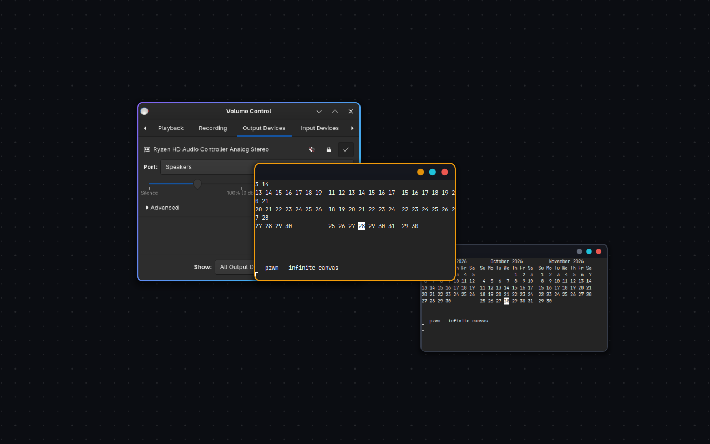

# pzwm

**Wayland-композитор з нескінченним полотном, написаний на Rust.** Вікна
лежать на безкінечному полотні, яке можна рухати й масштабувати як у
дизайнерській програмі: затисни колесо миші й тягни, крути колесо — зум
навколо курсора, віддали — і бачиш усе одразу.

[English →](README.md)



### Два режими відкриття вікон

| Режим | Що відбувається, коли відкривається вікно | Як увімкнути |
|---|---|---|
| **center** (за замовчуванням) | з'являється одразу посередині екрана, 90 % × 90 % | `new_window_placement = "center"` |
| **pick** | чекає, поки протягнеш мишкою його зону, і займає саме це місце й розмір (`Esc` — посередині) | `new_window_placement = "pick"` |

Перемкнути: **pzwm config** → Canvas → *Where new windows open*, або в
`~/.config/pzwm/config.toml` у секції `[canvas]` — діє одразу після
збереження файла. В обох режимах `Super+O` (або `Super+Ctrl` + ліва
кнопка) вибирає місце лише для наступного вікна, а діалоги й власні
наступні вікна програми завжди відкриваються біля свого вікна.
Детальніше: [Де відкриваються нові вікна](#де-відкриваються-нові-вікна).

## Зміст

1. [Що нового](#що-нового)
2. [Можливості](#можливості)
3. [Встановлення](#встановлення)
4. [Перші кроки](#перші-кроки)
5. [Як це працює](#як-це-працює)
6. [Керування](#керування)
7. [Де відкриваються нові вікна](#де-відкриваються-нові-вікна) (підказки розміру, номери вікон)
8. [Вікна на екрані: сітка, половини, кути](#вікна-на-екрані-сітка-половини-кути)
9. [Допоміжні програми](#допоміжні-програми)
10. [Налаштування](#налаштування)
11. [Паралакс шпалер](#паралакс-шпалер)
12. [Профілі робочого столу](#профілі-робочого-столу)
13. [Групи, закладки, пошук](#групи-закладки-пошук)
14. [Малювання, презентація, розкладка, семантичний зум](#малювання-презентація-розкладка-семантичний-зум)
15. [Скрипти: pzwm msg](#скрипти-pzwm-msg)
16. [Проблеми](#проблеми)
17. [Ліцензія](#ліцензія)

## Що нового

| Що | Клавіші / опція | Де детальніше |
|---|---|---|
| Вибір місця для нового вікна: протягни зону — вікно займе саме її | `Super+O`, `Super+Ctrl`+ліва, `Super+Shift+Return`; для кожного вікна — `[canvas] new_window_placement = "pick"` | [Де відкриваються нові вікна](#де-відкриваються-нові-вікна) |
| Вікна, які програма відкриває сама (зустріч у Zoom, діалоги), стають біля свого, камера робить fit; вікна, які запускаєш ти, — ніколи | `[canvas] place_near_siblings` | [Де відкриваються нові вікна](#де-відкриваються-нові-вікна) |
| Ідеальний розмір: весь екран без бару на 100 %; ще раз — назад | `Super+Shift+F` (на весь екран тепер `Super+Ctrl+F`) | [Керування](#керування) |
| Підказки розміру: ідеальні розміри притягують зону чи край вікна й видні контуром | `Alt` — вільний розмір; `[canvas] size_hints` | [Підказки розміру](#підказки-розміру) |
| Сітка поверх екрана: протягни по клітинках — будь-які половини, третини, чверті | `Super+T`; `[canvas] tile_grid` | [Вікна на екрані](#вікна-на-екрані-сітка-половини-кути) |
| Розкладка на 100 %: розміри в справжніх пікселях за будь-якого зуму (або закріпити) | `[canvas] tile_mode` | [Вікна на екрані](#вікна-на-екрані-сітка-половини-кути) |
| Третини й чверті | `Super+[` / `]` ще раз — ⅓, ⅔; кинути в кут | [Вікна на екрані](#вікна-на-екрані-сітка-половини-кути) |
| Закріплення зберігає місце й видимий розмір; закріплене лишається закріпленим у сітці | `Super+P` | [Вікна на екрані](#вікна-на-екрані-сітка-половини-кути) |
| Номери вікон за розташуванням (зліва зверху, справа зверху, стовпцями, за відкриттям), більше 10 | `Super+1` … `0`, тримай `Super` для 11, 12…; `[general] window_numbers` | [Номери вікон](#номери-вікон) |
| Демонстрація екрана в Discord і браузерах не завмирає (ext-image-copy-capture) | | [Проблеми](#проблеми) |
| Трей у барі DMS | віджет System Tray | [Проблеми](#проблеми) |
| Правила вікон спрацьовують і для програм із пізнім заголовком (Chrome, Electron) | `[[rule]]` | [Налаштування](#налаштування) |
| Пошук наближає знайдене вікно; `Super+G` удруге розгортає щойно згорнуту групу; у Desktop Profiles одразу можна вводити назву | | [Групи, закладки, пошук](#групи-закладки-пошук) |

## Можливості

**Полотно і вікна**
- **Нескінченне полотно** із сіткою з точок, яка лишається читабельною на
  будь-якому зумі (крок підлаштовується, як у Figma).
- **Рух як у дизайнері**: затисни середню кнопку (колесо) і тягни — і по
  порожньому місцю, і **над вікнами**. Звичайний клік середньою кнопкою все
  одно доходить до програми. Тягнути лівою по порожньому полотну теж можна.
- **Зум до курсора**: колесо над порожнім місцем або `Super+колесо` будь-де;
  щипок на тачпаді; свайп трьома пальцями — рух.
- `Super+C` — активне вікно по центру із зумом на весь екран. Нові вікна
  відкриваються на 90 % × 90 % екрана.
- **Вікно там, де хочеш**: виділи зону (`Super+O` або `Super+Ctrl` + ліва
  кнопка) — наступне вікно її заповнить; `Super+Shift+Return` — те саме й
  одразу термінал у ній.
- **Режим вибору місця** (`[canvas] new_window_placement = "pick"`):
  кожне нове вікно чекає, поки виділиш його зону, і займає саме її;
  `Esc` — посередині. Діалоги й наступні вікна програми не чекають —
  відкриваються біля батьківського.
- **Підказки розміру**: коли виділяєш зону чи тягнеш край вікна, ідеальні
  розміри притягують його й видні контуром: увесь екран на 100 % (пікселі
  програми = пікселі екрана), половини, чверть, 1280 × 720, 1920 × 1080.
  Сповіщення називає розмір; `Alt` — вільний розмір.
- **Номери вікон за розташуванням**: `Super+1` … `Super+0` рахують від
  лівого верхнього кута (або правого, стовпцями, за порядком відкриття);
  тримай `Super` і набирай далі — 11, 12 і так без обмежень.
- **Сітка** (`Super+T`): сітка 6 × 4 поверх екрана; протягни по клітинках —
  вікно займе їх: половина, третина, чверть, шоста, будь-який блок.
  Кілька вікон поруч — як завгодно.
- **Вікна однієї програми поруч**: вікно, яке програма відкриває сама
  (вікно зустрічі Zoom, діалог), стає біля того, з якого воно, або над ним,
  і камера робить fit (не більше 100 %). Вікно, яке запускаєш ти сам,
  туди не ставиться, навіть якщо програма вже відкрита.
- **Ідеальний розмір** (`Super+Shift+F`): вікно на весь екран без бару на
  100 %; ще раз — назад до свого розміру й місця.
- Розгорнути, на весь екран, закріпити на екрані, магнітні краї;
  `Super+[` / `Super+]` — половина, ще раз ⅓ і ⅔; кинути вікно до краю —
  половина, у кут — чверть.
- **Міні-карта** з живими прев'ю (`Super+M`), огляд усіх вікон (`Super+Tab`).
- **Паралакс шпалер** (увімкнений): фон трохи зсувається проти камери, коли
  рухаєш полотно. Повільне гойдання саме по собі — окремо і вимкнене.
- **Малювання на полотні** (`Super+Shift+D`): нотатки й стрілки між вікнами.
- **Семантичний зум**: на зумі нижче 30 % вікна стають картками з іконкою
  програми.
- **Презентація** (`Super+F5`): камера по черзі літає по закладках, як по
  слайдах.
- **Розкладка за запитом** (`Super+Shift+A` / `Super+Alt+A`): вишикувати
  групу або весь воркспейс сіткою чи рядком — один раз, не режим тайлінгу.
- **Пошук** (`Super+/`, з огляду ще й наближає знайдене вікно), **історія камери** (`Super+,` / `Super+.`),
  **закладки** (`Super+Alt+Shift+1…5` / `Super+Alt+1…5`), **групи**,
  **скретчпад** (``Super+` ``), **правила вікон** (`[[rule]]`).

**Робочий стіл**
- 10 воркспейсів у барі DankMaterialShell.
- **Профілі**: зберегти, де лежать програми, і повернути пізніше; вікно
  **Desktop Profiles** (`Super+Shift+P`) для керування ними; профіль
  `autosave` зберігається сам і рятує після краша.
- Трей у барі (віджет System Tray у DankMaterialShell або трей waybar) —
  для програм, що згортаються в трей.
- Кілька моніторів, дзеркало на телевізор, демонстрація екрана
  (ext-image-copy-capture і wlr-screencopy, працює в Discord, браузерах,
  OBS), X11 через
  xwayland-satellite, таскбари, kanshi / wdisplays / wlr-randr, нічний
  режим, fcitx5, графічні планшети.

**Налаштування**
- **pzwm config** — програма для всіх опцій і шорткатів, плюс ярлики
  **Display Settings** і **Desktop Profiles**.
- Звичайний TOML-конфіг, застосовується після збереження.
- `pzwm msg …` — керування з скриптів, JSON і потік подій.

## Встановлення

Потрібен Rust ≥ 1.85 і стандартні бібліотеки для Wayland-композиторів.

```sh
git clone https://github.com/Makstvell/pzwm
cd pzwm
./install.sh --deps   # пакети (Arch, Fedora, Debian/Ubuntu, openSUSE, Void), збірка, встановлення
# або, якщо бібліотеки вже є:
./install.sh
```

Скрипт збирає release-версію і через `sudo` ставить у `/usr/local`:
`pzwm`, `pzwm-session`, `pzwm-config`, ярлики **pzwm config**,
**Display Settings** і **Desktop Profiles**, сесію для екрана входу,
`pzwm-session.target` і налаштування порталів. Конфіг з коментарями
копіюється в `~/.config/pzwm/config.toml` лише якщо його ще немає.
Видалити: `./install.sh --uninstall`. Нова збірка діє після перелогіну.

Варто доставити: `xwayland-satellite grim slurp wl-clipboard xdg-desktop-portal-gtk`.

Логи: `journalctl --user -t pzwm -b`. Як запустити — у
[Перших кроках](#перші-кроки).

## Перші кроки

1. Спробувати у своїй сесії: `pzwm --nested` відкриє pzwm у вікні.
2. Запуск: вийди з сесії й обери **pzwm** на екрані входу (або
   `pzwm-session` з TTY).
3. Термінал — `Super+Return`, лаунчер — `Super+D`. З
   `new_window_placement = "pick"` вікно чекає: протягни його зону
   (`Esc` — посередині).
4. Тримай `Super` і крути колесо — зум; затисни середню кнопку й тягни —
   рух.
5. Вікна поруч — `Super+T` (протягни по клітинках), одне на весь екран на
   100 % — `Super+Shift+F`.
6. Налаштування — **pzwm config** у лаунчері.

## Як це працює

| Поняття | Що означає |
|---|---|
| **Полотно** | Безкінечна площина: у вікон є місце на ній і справжній розмір; зум лише змінює, наскільки великим усе виглядає. |
| **Камера** | Яку частину полотна показує монітор: позиція і зум. Рух і зум рухають камеру, а не вікна. |
| **Воркспейс** | Одне з 10 окремих полотен, кожне зі своєю камерою. |
| **Стани вікна** | *на полотні* (рухається з ним), *закріплене* (стоїть на екрані, полотно рухається під ним), *розгорнуте*, *на весь екран*. |
| **Розмір і зум** | Розмір вікна — у логічних пікселях (роздільність монітора, поділена на масштаб). На зумі 100 % піксель програми = піксель екрана: текст чіткий і справжнього розміру; віддалено те саме вікно просто виглядає меншим. Тому сітка, `Super+Shift+F` і підказки розміру працюють на 100 %: вікна, розставлені одне за одним, стикуються за будь-якого зуму, з якого почав. |
| **Нові вікна** | Посередині, або (режим вибору) чекають, поки протягнеш їхню зону. Діалоги й власні наступні вікна програми — біля свого вікна. |
| **Бар, лаунчер, сповіщення** | Не частина pzwm, це інші програми, наприклад DankMaterialShell. |

## Керування

| | |
|---|---|
| середня кнопка + тягнути (будь-де), ліва по порожньому, `Super+ліва` | рух полотна |
| колесо над порожнім, `Super+колесо` будь-де, щипок | зум до курсора |
| тягнути заголовок, `Super+Shift+ліва` | перемістити вікно |
| краї й кути вікна, `Super+права` | змінити розмір |
| подвійний клік по заголовку, `Super+F` / `Super+Ctrl+F` | розгорнути / на весь екран |
| `Super+Shift+F` | ідеальний розмір: весь екран без бару на 100 % (ще раз — назад) |
| `Super+P` | закріпити на екрані ↔ назад на полотно |
| `Super+Tab` / `Super+Z`, `Super+M` | огляд, міні-карта |
| `Super+C` | вікно по центру, зум на весь екран |
| `Super+Home`, `Super+BackSpace`, `Super+=` / `Super+-` | на початок, зум 100 %, зум |
| `Super+стрілки`, `Alt+Tab` | фокус |
| `Super+1..0`, `Super+Ctrl+1..0`, `Super+Shift+1..0` | вікно за номером (від лівого верхнього кута; тримай `Super` і набирай далі — 11, 12…), воркспейс, перенести вікно |
| `Super+/` | пошук вікна, групи чи закладки |
| `Super+,` / `Super+.` | камера назад / вперед |
| `Super+Alt+Shift+1..5` / `Super+Alt+1..5` | зберегти закладку / до закладки |
| ``Super+` `` | скретчпад |
| `Super+Ctrl+G` / `Super+Alt+G` / `Super+G` / `Super+Shift+G` | у групу / з групи / згорнути / показати групу |
| `Super+Shift+D` | олівець увімк. / вимк. |
| з олівцем: ліва / `Shift`+ліва / права | малювати / стрілка / стерти |
| з олівцем: `1`…`9`, `Ctrl+Z`, `Delete`, `Esc` | колір, скасувати, очистити воркспейс, вимкнути олівець |
| `Super+Alt+D` | сховати / показати малюнки |
| `Super+F5`, `Super+Page Down` / `Page Up` | презентація, наступний / попередній слайд |
| `Super+Shift+A` / `Super+Alt+A` | розкласти сіткою / рядком |
| `Super+Shift+P` | вікно **Desktop Profiles** |
| `Super+T` | сітка: протягнути по клітинках (або стрілки, Shift+стрілки, Enter) |
| `Super+[` / `Super+]` | ліва / права половина; ще раз — ⅓, потім ⅔ |
| кинути вікно до лівого / правого краю, у кут | половина / чверть екрана |
| `Super+O`, потім тягнути / `Super+Ctrl`+ліва | зона для наступного вікна |
| `Super+Shift+Return` | зона, потім термінал у ній |
| `Super+Q`, `Super+Shift+R`, `Super+Ctrl+Q` | закрити, перечитати конфіг, вийти |

`Super+G` одразу вдруге розгортає щойно згорнуту групу, навіть якщо фокус
перейшов на вікно іншої групи.

## Де відкриваються нові вікна

| Вікно | Де з'являється |
|---|---|
| після вибору зони | заповнює зону: `Super+O` і протягнути прямокутник (`Esc` — скасувати), або одразу `Super+Ctrl`+ліва; `Super+Shift+Return` — зона і термінал у ній |
| будь-яке інше, з `new_window_placement = "pick"` | поки ніде: чекає, доки протягнеш його зону (курсор — хрестик), і займає саме її, з розміром; клік без протягування — далі чекає; `Esc` — посередині. Кілька нових вікон чекають по черзі |
| діалог (є батьківське вікно) | по центру над батьківським; камера робить fit (не більше 100 %) |
| ще одне вікно, яке програма відкрила сама (той самий процес, що й вікно на воркспейсі, і ти нічого щойно не запускав) | поруч із ним (праворуч, інакше знизу, ліворуч, зверху — перший вільний бік), камера робить fit (не більше 100 %); вікно до 60 % розміру іншого — над ним, як діалог. Вікно, яке запустив ти (бінд, лаунчер, `pzwm msg spawn`, протягом 20 с), або новий процес тієї ж програми — твоє і відкривається як будь-яке нове |
| усе інше (`new_window_placement = "center"`, за замовчуванням) | посередині екрана, 90 % × 90 % |

- Вибрана зона чекає на вікно до хвилини й до того видна на полотні.
  Діалоги й вікна фіксованого розміру її не забирають.
- Правила вікон з `position` чи `size` діють як і раніше; вибрана зона
  важливіша.
- Розміщення поруч увімкнене за замовчуванням; вимкнути:
  `[canvas] place_near_siblings = false`.
- З `tile_mode = "zoom"` (за замовчуванням) на початку вибору камера
  переходить на 100 %: екран показує справжні пікселі, а підказка «весь
  екран» — рівно екран без бару.
- Режим вибору не питає про вікна з правилом `position` чи `workspace`,
  вікна з профілю, скретчпад, діалоги й вікна фіксованого розміру.
- Зі скриптів: `pzwm msg area`, `area spawn <команда>`, `area cancel`,
  `area rect X,Y WxH` (координати полотна, без миші). У режимі вибору
  `area rect` ставить вікно, що чекає, а `area cancel` — посередині;
  у `pzwm msg windows --json` такі вікна мають `"awaiting_pick": true`.

### Підказки розміру

Коли виділяєш зону (`Super+O`, режим вибору) або тягнеш край вікна,
найближчий **ідеальний розмір** з'являється контуром, а ближче ~24 px
розмір притягується до нього; сповіщення називає його (наприклад
`1687 × 940: the whole screen at 100 %`). Ідеальні: увесь екран на 100 %,
половини (поруч / одна над одною), чверть, 1280 × 720, 1920 × 1080. Це
логічні пікселі — враховують роздільність і масштаб монітора. `Alt` під
час перетягування — вільний розмір; `[canvas] size_hints = false` —
вимкнути.

### Номери вікон

`Super+1` … `Super+9`, `Super+0` (вікно 10) — до вікна воркспейсу за
номером. Тримай `Super` і набирай далі: `Super`+`1`, `2` — вікно 12 (якщо
вікон менше, рахується остання цифра). Як рахувати —
`[general] window_numbers`: `"rows"` (рядки згори, кожен зліва направо,
за замовчуванням), `"rows-rtl"` (рядки згори, справа наліво), `"columns"`
(стовпці зліва, згори вниз), `"opened"` (порядок відкриття). Зі скриптів:
`pzwm msg window 12`.

## Вікна на екрані: сітка, половини, кути

Вікна й далі лежать на полотні; це ставить вікно на частину того, що
видно на екрані. Щоб результат не залежав від зуму, `[canvas] tile_mode`:

| `tile_mode` | Що буде |
|---|---|
| `"zoom"` (за замовчуванням) | камера спершу переходить на 100 % (центр екрана лишається), потім вікно отримує розмір клітинок у справжніх пікселях: текст 1:1, чіткий з масштабом монітора, і вікна, розкладені одне за одним, стикуються |
| `"pin"` | вікно закріплюється на екрані 1:1 на цих клітинках, полотно рухається під ним |
| `"canvas"` | на поточному зумі, як раніше |

Закріплене вікно лишається закріпленим, коли його розкладаєш, а `Super+P`
в обидва боки зберігає місце й видимий розмір вікна.

| Як | Що буде |
|---|---|
| `Super+T`, протягнути по клітинках | активне вікно займає ці клітинки. Без миші: стрілки рухають блок, `Shift`+стрілки збільшують, `Enter` — застосувати, `Esc` (або права кнопка) — закрити сітку |
| `Super+[` / `Super+]` | ліва / права половина; ще раз за 3 с — третина, потім дві третини |
| кинути вікно до лівого / правого краю | ця половина |
| кинути його ближче 120 px до кута | ця чверть |
| кинути до верхнього краю | розгорнути |

Приклади для сітки 6 × 4: три клітинки в ширину — половина, дві —
третина, три в ширину й дві в висоту — чверть. Тож одне вікно справа на
половину, друге зліва зверху на чверть, третє зліва знизу — або будь-як
інакше. `[canvas] tile_grid = "4x4"` (до 12x12) — інша сітка. Зі
скриптів: `pzwm msg tile`, далі `tile left|right|up|down`,
`tile grow <напрям>`, `tile apply`, `tile cancel`.

## Допоміжні програми

Три ярлики в лаунчері (rofi, fuzzel, DMS). Це одна програма `pzwm-config`,
відкрита на різних сторінках; останні два видно лише під pzwm.

| Назва в лаунчері | Команда | Для чого |
|---|---|---|
| **pzwm config** | `pzwm-config` | усі налаштування і шорткати |
| **Display Settings** | `pzwm-config --page monitors` | роздільність, частота, масштаб, позиція, дзеркало моніторів |
| **Desktop Profiles** | `pzwm-config --page profiles`, `Super+Shift+P` | зберегти, завантажити, перейменувати, видалити профілі |

`--page` приймає назву будь-якої сторінки (`general`, `canvas`,
`parallax`, `draw`, `shortcuts`…); якщо програма вже відкрита, вона
просто перемкнеться на цю сторінку.

`nwg-displays` під pzwm не працює (уміє лише sway, Hyprland, niri і Mango);
замість нього **Display Settings**, або wdisplays, wlr-randr, kanshi.

Сторінки pzwm config: General (автостарт, масштаб, курсор, автозбереження,
програма для пошуку, як нумерувати вікна), Input, Canvas (розмір нових
вікон, де вони відкриваються — посередині чи вибір, вікна поруч, сітка й
режим розкладки, підказки розміру, зум, сітка фону, семантичний зум), Monitors,
Appearance, Scratchpad, Animation, Parallax, Drawing (товщина й кольори
олівця), Presentation (секунд на слайд), Minimap, Shortcuts, Mouse,
Profiles. Зберігаються лише змінені рядки, коментарі лишаються, файл
перевіряється `pzwm --check-config`, попередній кладеться в
`config.toml.bak`.

## Налаштування

`~/.config/pzwm/config.toml`; усі опції з коментарями — у
[`resources/default-config.toml`](resources/default-config.toml).
Перевірка: `pzwm --check-config`. Зміни застосовуються після збереження;
з помилкою лишається старий конфіг і приходить сповіщення.

| Секція | Що там |
|---|---|
| `[general]` | автостарт, масштаб, курсор, X11, `picker`, `autosave`, `window_numbers` |
| `[input]` | розкладки (до 4), XKB, повтор клавіш, тачпад |
| `[canvas]` | зум, рух, прилипання, сітка, розмір нових вікон, `semantic_zoom`, `new_window_placement` (`center`/`pick`), `place_near_siblings`, `tile_grid`, `tile_mode`, `size_hints` |
| `[[output]]` | монітор: режим, масштаб, позиція, `mirror`, `disable` |
| `[appearance]`, `[animation]` | вигляд і анімації |
| `[parallax]` | паралакс шпалер, див. нижче |
| `[draw]` | товщина (`width`) і кольори (`colors`) олівця |
| `[presentation]` | `interval` — секунд на слайд, 0 — за клавішею |
| `[minimap]`, `[scratchpad]`, `[[rule]]` | міні-карта, випадне вікно, правила вікон |
| `[binds]`, `[mouse]` | шорткати і миша |

Нові дії для `[binds]` і `pzwm msg`: `draw [on|off|undo|clear|hide|color N|color next]`,
`arrange grid|row|column`, `present [start|stop|next|prev]`,
`profile save|load|delete NAME`, `profile rename OLD NEW`,
`area [spawn CMD]|cancel|rect X,Y WxH`, `tile [left|right|up|down|grow DIR|apply|cancel]`.
Нова дія миші: `select-area`.

Правила вікон (`[[rule]]`) перевіряються при відкритті й ще 5 секунд після
(поки вікно не пересунеш), тож програми, які ставлять заголовок пізніше
(Chrome, Electron), теж під них потрапляють.

## Паралакс шпалер

Базові значення:

```toml
[parallax]
enabled = true
strength = 0.15       # наскільки далеко, частка ширини екрана (0.01 .. 0.15)
follow_camera = true  # зсув проти полотна, коли його рухаєш
swing = false         # ще й повільно гойдатися вліво-вправо самому
period = 60.0         # секунд на одне гойдання (лише з swing = true)
```

Шпалера (awww, swaybg, hyprpaper…) збільшена на `strength`, тож краї
ніколи не видно. `follow_camera` — фон рухається трохи назустріч полотну,
як далекий задник; це нічого не коштує, бо рух полотна все одно
перемальовує екран. `swing = true` додає повільне гойдання — лише тоді pzwm
перемальовує екран ~30 разів на секунду. За замовчуванням гойдання
вимкнене і лишається тільки слідування за полотном.

## Профілі робочого столу

**Вікно Desktop Profiles** (`Super+Shift+P`, ярлик у лаунчері або
сторінка Profiles у pzwm config):

1. Введи назву в *Save the desktop* і натисни Enter — поточний стан
   збережеться під цією назвою.
2. Біля кожного профілю видно вікна, програми, воркспейси, малюнки й час
   збереження. **Load** повертає все на місця. Кнопки поруч: замінити
   поточним станом, перейменувати, видалити (з підтвердженням).
3. Сторінка одразу говорить з pzwm, кнопка Save тут не потрібна. Коли
   вікно відкривається, курсор уже в полі назви: `Super+Shift+P`, назва,
   Enter — і стіл збережено.

З терміналу:

```sh
pzwm msg profile save work          # зберегти як "work"
pzwm msg profile load work          # повернути все
pzwm msg profile list               # назви; --json — з подробицями
pzwm msg profile rename work office
pzwm msg profile delete office
```

- **Зберігається**: для кожного вікна програма, воркспейс, місце, розмір,
  розгорнутість і група; вид кожного воркспейсу; який воркспейс на якому
  моніторі; малюнки на полотні.
- **Завантаження** повертає відкриті вікна, запускає відсутні програми
  (`gtk-launch`, тож app id має збігатися з `.desktop`) і ставить їхні
  вікна на місце, коли ті з'являться (до хвилини).
- Файли — у `~/.local/state/pzwm/profiles/<назва>.json`; назви з літер,
  цифр, `-` і `_`.
- **Автозбереження**: з `[general] autosave = true` (за замовчуванням) pzwm
  кожні 2 хвилини і при виході зберігає профіль `autosave` (порожній стіл —
  ніколи). Після краша: `pzwm msg profile load autosave` або Load у вікні.

## Групи, закладки, пошук

- **Група** — вікна з однією назвою; навколо них рамка кольору, що
  залежить від назви. `Super+G` згортає групу (лишається рамка), клік по
  рамці чи `Super+G` над нею — розгортає. Якщо одразу натиснути `Super+G`
  ще раз, розгорнеться саме щойно згорнута група, навіть коли фокус уже на
  вікні іншої групи.
- **Закладки** пам'ятають місце камери на воркспейсі й переживають
  перезапуск (`~/.local/state/pzwm/bookmarks.json`).
- **Пошук** (`Super+/`) показує всі вікна (і з інших воркспейсів, і в
  згорнутих групах), групи й закладки через rofi, fuzzel чи wofi
  (`[general] picker`). Якщо знайдене вікно було б дрібною мініатюрою
  (наприклад, з огляду), камера наближається до нього.
- **Скретчпад** (``Super+` ``): випадне вікно; будь-яке вікно може ним
  стати правилом `scratchpad = true`.

## Малювання, презентація, розкладка, семантичний зум

**Малювання** — полотно як дошка: нотатки й стрілки від вікна до вікна.

1. `Super+Shift+D` вмикає олівець, курсор стає хрестиком.
2. Ліва кнопка малює, `Shift`+ліва — пряма стрілка, права стирає штрихи,
   яких торкається. Малювати можна й поверх вікон; бар і міні-карта
   працюють як завжди.
3. `1`…`9` — колір з `[draw] colors`, `Ctrl+Z` — скасувати, `Delete` —
   очистити воркспейс, `Esc` (або `Super+Shift+D`) — вимкнути олівець.
   Поки олівець увімкнений, ці клавіші не доходять до програм.
4. `Super+Alt+D` ховає або показує всі малюнки.

Штрихи лежать на полотні й рухаються та зумляться разом з вікнами.
Товщина задається в пікселях екрана на тому зумі, де малюєш: віддалено —
товсті лінії для загальної картини, зблизька — тонкі нотатки. Малюнки
зберігаються для кожного воркспейсу в `~/.local/state/pzwm/drawings.json`
і в профілях.

**Презентація**: збережи кілька закладок на воркспейсі
(`Super+Alt+Shift+1…5` або `pzwm msg bookmark save intro`) і натисни
`Super+F5`. Камера по черзі летить до кожної: спочатку з номерами (1, 2, …
10), потім решта за назвою. `Super+Page Down` / `Page Up` — крок,
`Super+F5` — завершити й повернутися, звідки почав. З
`[presentation] interval = 8` слайди перемикаються самі кожні 8 секунд.

**Розкладка**: `Super+Shift+A` — група активного вікна сіткою (≈√n у
рядку), `Super+Alt+A` — одним рядком (`arrange column` — стовпцем). Поза
групою — усі вікна воркспейсу. Розміри й порядок читання (згори вниз,
зліва направо) зберігаються, камера показує результат. Це разова дія:
потім вікна можна вільно рухати.

**Семантичний зум**: коли віддаляєшся нижче `[canvas] semantic_zoom`
(0.3, тобто 30 %), дрібна мініатюра вікна плавно стає карткою в кольорі
програми з її іконкою посередині. Іконки беруться з `.desktop` і теми
hicolor (лише PNG; програми тільки з SVG-іконкою отримують картку без
неї). `semantic_zoom = 0` вимикає.

## Скрипти: pzwm msg

- `pzwm msg windows [--json]`, `outputs [--json]`, `heads --json`; у JSON
  вікна мають також `title`, `group`, `hidden`, `scratchpad` і
  `awaiting_pick` (вікно чекає на вибір місця).
- `pzwm msg subscribe` — JSON-події (вікна, фокус, воркспейс), по одній на рядок.
- `pzwm msg bookmark list`, `group list`, `profile list --json`.
- `pzwm msg draw …`, `present …`, `arrange …` друкують помилку, якщо щось не так.
- Будь-яка дія з `[binds]` теж працює: `pzwm msg workspace 3`, `pzwm msg fit`.

Схожі проєкти: [docs/similar-projects.md](docs/similar-projects.md).

## Проблеми

| Проблема | Що робити |
|---|---|
| Щось не працює | Лог: `journalctl --user -t pzwm -b` |
| DMS-бар не з'являється | `systemctl --user add-wants pzwm-session.target dms.service` |
| Нове вікно не з'являється | Увімкнено режим вибору (`new_window_placement = "pick"`): вікно чекає. Протягни зону (клік не рахується) або `Esc` — посередині |
| Курсор — хрестик, кліки не доходять до програм | Зараз вибирається зона або відкрита сітка: протягни або натисни `Esc` |
| `Super+Shift+F` більше не на весь екран | Тепер це ідеальний розмір; на весь екран — `Super+Ctrl+F` (або `"Super+Shift+F" = "fullscreen"` у `[binds]`) |
| Друге вікно відкритої програми питає місце | Його запустив ти (бінд, лаунчер, `pzwm msg spawn`) або це новий процес — такі відкриваються як нові. Поруч стають лише вікна, які програма відкриває сама |
| Розкладені вікна різного розміру | Залиш `[canvas] tile_mode = "zoom"` (за замовчуванням): розкладка спершу йде на 100 %. З `"canvas"` розмір залежить від зуму |
| Номери вікон не в тому порядку | `[general] window_numbers`: `rows`, `rows-rtl`, `columns` або `opened` |
| Демонстрація екрана (Discord, браузер) показує одну нерухому картинку або нічого | Виправлено: pzwm тепер підтримує ext-image-copy-capture, тож xdg-desktop-portal-wlr не йде старим шляхом wlr-screencopy, який у версії 0.8.4 зупиняється після першого кадру (issue #411); кадри ще й у форматі XRGB8888, який просять клієнти PipeWire. Перезібрати й перелогінитись. Перевірка: `journalctl --user -u xdg-desktop-portal-wlr` має показати `using ext_image_copy_capture` |
| У DMS-барі немає іконок трею | Додай віджет **System Tray** (налаштування DMS → Widgets) або `{"id": "systemTray", "enabled": true}` у `rightWidgets` файла `~/.config/DankMaterialShell/settings.json`. Програми, що згортаються в трей (Discord, Telegram), будуть там |

## Ліцензія

GPL-2.0-or-later, див. [LICENSE](LICENSE).
